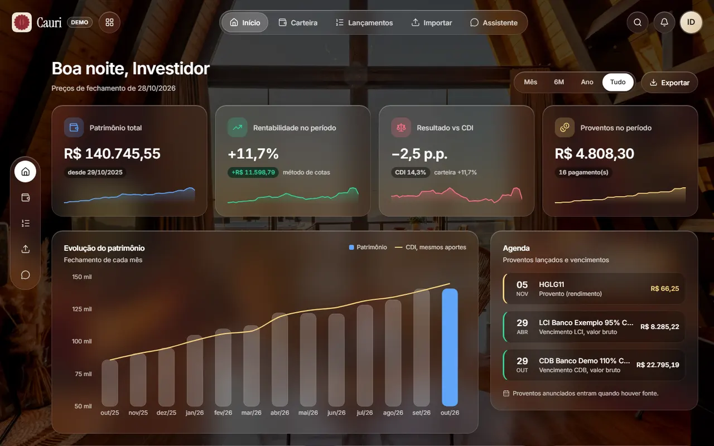
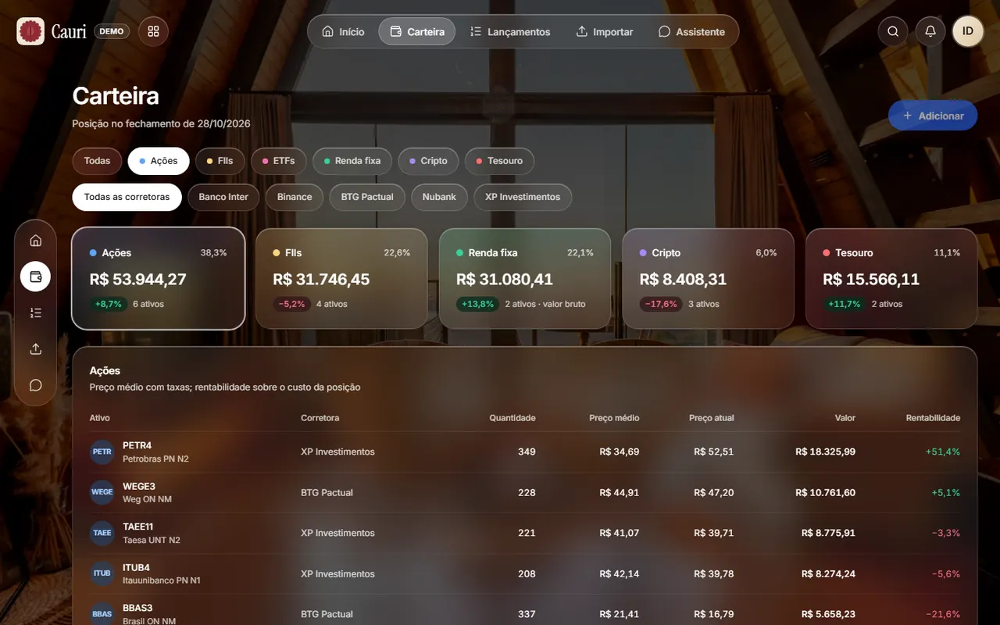
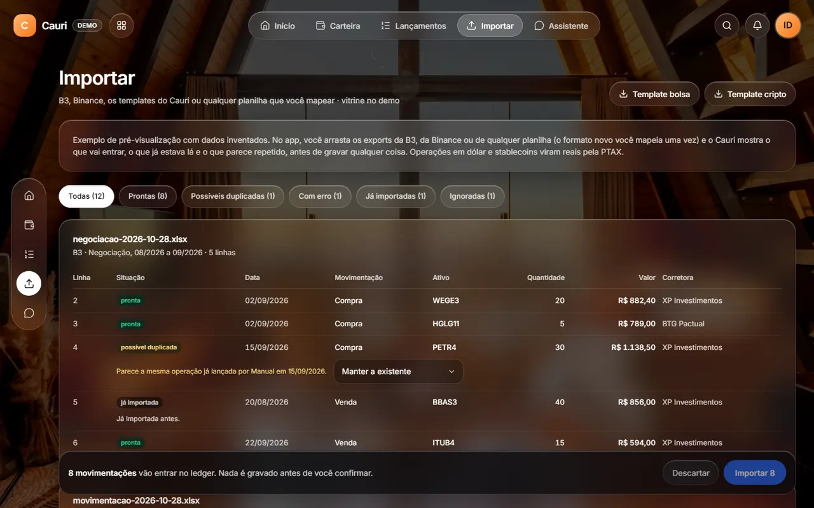
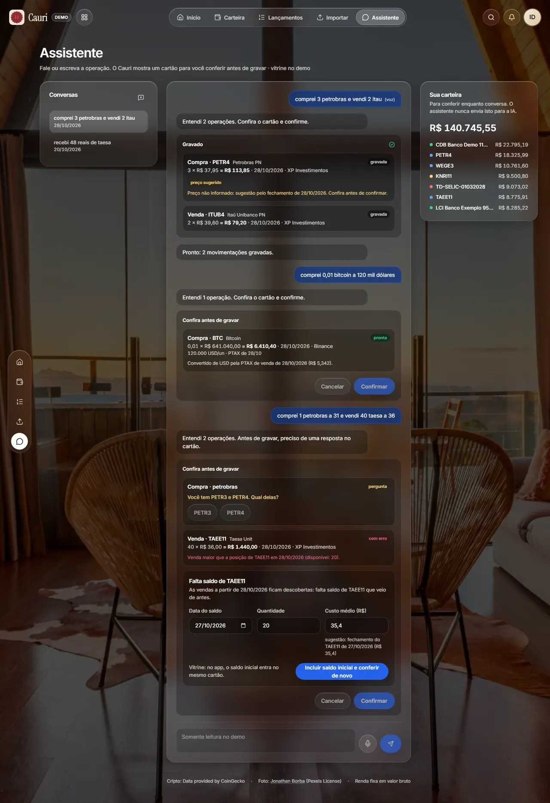
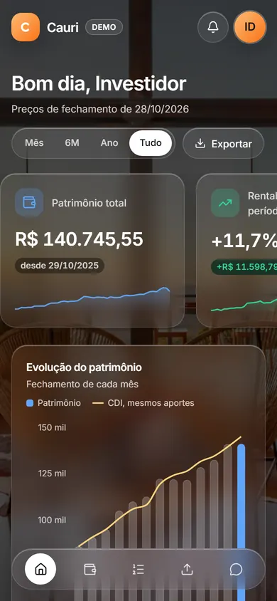
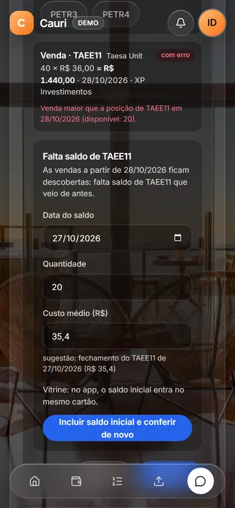
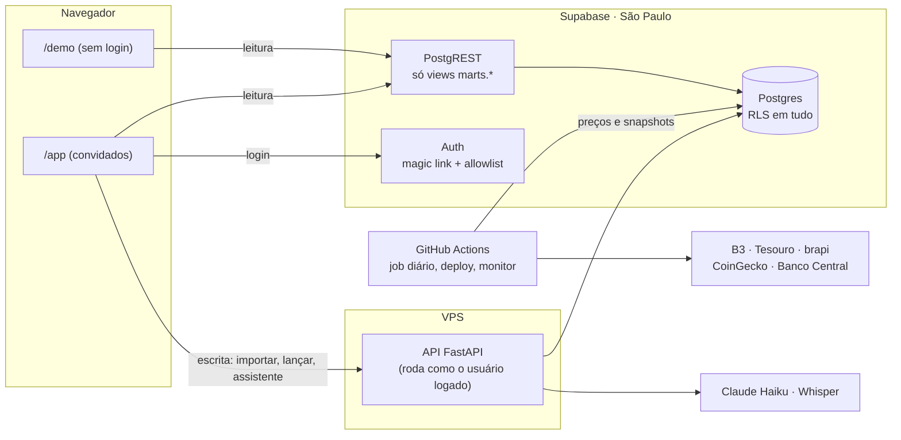

# Cauri

Carteira de investimentos que junta ações, FIIs, ETFs, Tesouro Direto, renda fixa e cripto num lugar só e compara a rentabilidade com o CDI.
As operações entram pela planilha da corretora ou por uma frase falada ("comprei 3 petrobras"), e nada é gravado sem você conferir antes.

### [Abrir a demo ao vivo →](https://cauri.com.br/demo)

Sem login: uma carteira fictícia com preços reais de mercado, atualizados todo dia útil.



Projeto pessoal, usado por mim e por alguns amigos convidados, e peça de portfólio. Backend em
Python, banco no Supabase (Postgres), front em React e um LLM com escopo bem fechado.

## O que dá para fazer

- **Acompanhar a carteira:** posição, preço médio, proventos e rentabilidade de verdade
  (descontando aportes e retiradas), com a linha "e se esse dinheiro estivesse no CDI?"
  no gráfico.
- **Importar planilhas:** os exports da B3 e da Binance, um template próprio ou qualquer
  planilha com as colunas mapeadas uma vez. Antes de gravar, uma prévia mostra o que entra,
  o que já existia, o que parece repetido e o que tem erro, com o motivo. Importar o mesmo
  arquivo de novo não duplica nada.
- **Falar com o assistente:** "comprei 0,01 bitcoin a 120 mil dólares" vira um cartão com o
  valor convertido pela cotação oficial do dia; "comprei 1 petrobras" pergunta se é PETR3 ou
  PETR4. Confirmar no cartão é o que grava.

| Carteira | Importar | Assistente |
|---|---|---|
|  |  |  |

<p>
  
  
</p>

## Decisões técnicas

As quatro primeiras têm ADR completo em [`docs/adr/`](docs/adr/).

1. **[Leitura direto no Supabase, escrita pela API.](docs/adr/0001-leitura-direto-no-supabase-escrita-pela-api.md)**
   As telas leem views do Postgres pelo PostgREST e não dependem da API estar no ar; toda
   escrita passa por uma API Python que valida e explica o erro.
2. **[As regras do ledger moram no banco.](docs/adr/0002-invariantes-do-ledger-no-banco.md)**
   Vender mais do que se tinha em qualquer ponto da linha do tempo, apagar uma operação ou
   alterar um campo imutável é barrado por constraints e triggers. O Python valida antes só
   para dar uma mensagem amigável; quem garante é o Postgres.
3. **[RLS como único filtro de acesso.](docs/adr/0003-rls-como-unico-filtro-e-isolamento-do-demo.md)**
   Cada consulta roda com o usuário logado, e o Row Level Security decide o que ele vê. Não
   existe `where user_id = ...` espalhado pelo código. O demo usa um cliente sem sessão que
   só enxerga a carteira fictícia, com testes de banco provando o isolamento.
4. **[API numa VPS com Dockerfile portável.](docs/adr/0004-api-na-vps-com-dockerfile-portavel.md)**
   Sem custo a mais (a VPS já roda outros serviços), e a mesma imagem sobe no Cloud Run se
   precisar.
5. **O LLM nunca vê a carteira.** O Claude Haiku recebe só o que a pessoa escreveu (com um
   cartão aberto, também as frases anteriores da conversa) e a data de hoje, e devolve os
   campos por saída estruturada. Achar o ticker, resolver ambiguidade, sugerir preço e
   conferir saldo é Python determinístico e testado. O uso tem limite diário por pessoa, e
   os tokens de cada chamada aparecem no painel de admin.
6. **Importação idempotente e transparente.** Cada linha vira uma chave pelo conteúdo e pela
   posição entre linhas iguais, então reenviar um arquivo não duplica nada. Linha que não
   entra aparece com o motivo, nunca some calada. CPF e nome das planilhas não são gravados.

## Arquitetura



O backend é um monorepo Python com módulos de fronteira fixa (ledger, engine de cálculo,
importadores, assistente, ingestão de mercado), checada pelo import-linter no CI: a engine
de cálculo é pura, sem I/O, e só o ledger escreve movimentações. Detalhes em
[`docs/arquitetura.md`](docs/arquitetura.md).

## Qualidade e segurança

- Mais de 400 testes automatizados: Python com Postgres de verdade (pytest), banco em pgTAP
  (RLS, isolamento do demo, regras do ledger) e interface no Playwright.
- Os testes de interface medem o contraste WCAG AA do texto sobre a foto de fundo, a
  rolagem no celular e a CSP de produção.
- mypy estrito, ruff, import-linter, actionlint e gitleaks em todo o histórico, no CI de
  cada push.
- Login por magic link só para e-mails convidados; chaves de API só no servidor e nos
  secrets do GitHub, nunca no navegador.
- Backup semanal com o teste de restauração documentado ([`docs/backup.md`](docs/backup.md)).

## Stack

Python 3.13, FastAPI, psycopg 3 · Supabase (Postgres 17, Auth, PostgREST) · React 19, Vite,
Tailwind, Motion, Recharts, TanStack Query · Claude Haiku (Anthropic), Whisper (Groq) ·
Cloudflare Pages · Docker, Nginx, Certbot · GitHub Actions.

## Rodando localmente

Requer [uv](https://docs.astral.sh/uv/), [just](https://just.systems/), Docker, Node 22 e a
[CLI do Supabase](https://supabase.com/docs/guides/local-development).

```sh
cp .env.example .env
just db-start      # Supabase local
just sync          # dependências Python
just seed          # ativos, carteira demo com preços reais e admin inicial
just check         # lint, tipos, fronteiras entre módulos e testes
just api           # API em http://127.0.0.1:8000
cd web && npm ci && npm run dev   # front em http://127.0.0.1:5173/demo
```

Produção: [`docs/deploy.md`](docs/deploy.md). Próximos passos: [`docs/backlog.md`](docs/backlog.md).
