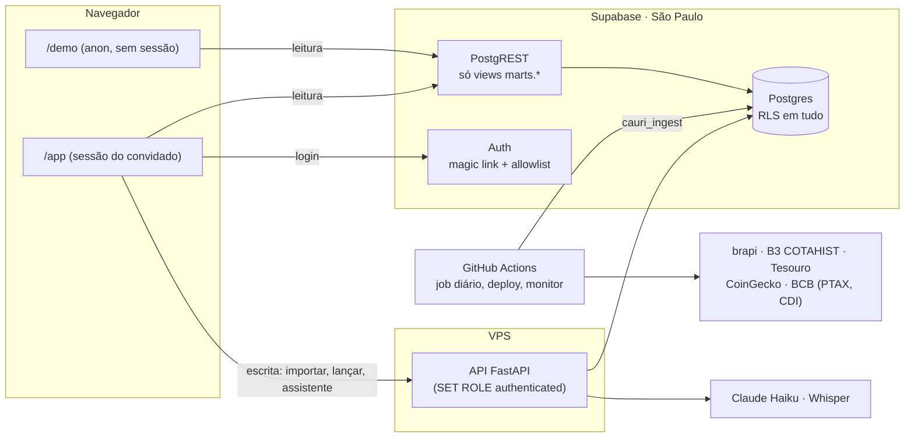

# Cauri

Portal de investimentos pessoal para poucos usuários convidados: ações e FIIs da B3,
Tesouro Direto, renda fixa atrelada ao CDI e cripto. As movimentações entram por planilha
(B3, Binance ou qualquer formato mapeado), por cadastro manual ou por um assistente que
entende frases em português, por texto ou voz. Nada é gravado sem passar por um cartão de
confirmação.

**Demo pública, sem login:** `/demo` (link do deploy de produção na seção abaixo), com uma
carteira fictícia e preços reais.


| Carteira | Importar | Assistente |
|---|---|---|
|  |  |  |

<p>
  
  
</p>

## O que tem

- **Carteira e rentabilidade:** preço médio pela regra da Receita, renda fixa em valor bruto
  com o CDI diário, rentabilidade pelo método de cotas (TWR) e a linha "mesmo dinheiro no
  CDI" no gráfico. Fechamento diário da B3, Tesouro, CoinGecko e BCB por um job agendado.
- **Importação:** exports da B3 (Negociação e Movimentação) e da Binance (trades, Convert,
  P2P, depósitos, extrato), templates próprios e mapeamento de colunas salvo como perfil.
  Pré-visualização com duplicados entre origens, erros explicados, conversão pela PTAX do
  dia e oferta de saldo inicial quando uma venda fica descoberta. Reenviar não duplica.
- **Assistente:** "comprei 3 petrobras e vendi 2 itau" vira um cartão com PETR4 e ITUB4. O
  modelo (Claude Haiku) só extrai os campos da frase; ticker, ambiguidade (PETR3 ou PETR4?),
  preço sugerido e conferência são Python determinístico. Voz pelo Whisper.
- **Acesso:** magic link, allowlist de convidados, RLS em todas as tabelas, admin com o log
  dos jobs e o uso do assistente.

## Arquitetura



Leitura vai direto no Supabase, pelas views do schema `marts`; escrita passa pela API
Python, que conecta com um role sem privilégios e roda cada requisição com o RLS do
usuário. Os módulos do backend (ledger, engine, importers, nl_assistant, ingest) têm
fronteiras checadas pelo import-linter no CI. Detalhes em
[`docs/arquitetura.md`](docs/arquitetura.md).

## Decisões técnicas

Resumo; os ADRs completos estão em [`docs/adr/`](docs/adr/).

1. **Leitura direto no Supabase, escrita pela API.** O `/demo` e as telas não dependem da
   API estar no ar, e o único filtro de acesso é o RLS (não há regra duplicada no código).
2. **As regras do ledger moram no banco.** Venda maior que a posição em qualquer ponto da
   linha do tempo, remoção física e campo imutável são barrados por constraints e triggers;
   o Python valida antes para dar uma mensagem amigável.
3. **RLS como único filtro e demo isolado.** O `/demo` usa um cliente sem sessão e só
   enxerga o usuário demo; quem sai da allowlist perde o acesso na hora.
4. **API numa VPS com Dockerfile portável.** Mesma imagem roda no Cloud Run, se precisar.
5. **O LLM nunca vê a carteira.** Ele recebe a frase e a data de hoje e devolve seis campos;
   o resto é código testável, com custo limitado por usuário e registrado no Admin.
6. **Importação idempotente e honesta.** Cada linha vira uma chave pelo conteúdo e pela
   ordem entre linhas iguais; nada some calado: o que não entra aparece com o motivo.

## Qualidade

- Python com mypy estrito, ruff e import-linter; testes de unidade e com Postgres real
  (pytest) e testes do banco em pgTAP (RLS, isolamento do demo, invariantes do ledger).
- Front em React e TypeScript, com testes de interface no Playwright que medem contraste
  WCAG AA sobre a foto de fundo, rolagem horizontal no celular e a CSP de produção.
- CI no GitHub Actions em todo push; gitleaks em todo o histórico; backup semanal com teste
  de restauração documentado ([`docs/backup.md`](docs/backup.md)).

## Stack

Python 3.13, FastAPI, psycopg 3 · Supabase (Postgres 17, Auth, PostgREST) · React 19, Vite,
Tailwind, Motion, Recharts, TanStack Query · Claude Haiku (Anthropic), Whisper (Groq) ·
Cloudflare Pages · Docker, Nginx, Certbot · GitHub Actions.

## Rodando localmente

Requer [uv](https://docs.astral.sh/uv/), [just](https://just.systems/), Docker, Node 22 e a
[CLI do Supabase](https://supabase.com/docs/guides/local-development).

```sh
cp .env.example .env
just db-start      # Supabase local
just sync          # dependências Python
just seed          # ativos, carteira demo com preços reais e admin inicial
just check         # lint, tipos, fronteiras entre módulos e testes
just api           # API em http://127.0.0.1:8000
cd web && npm ci && npm run dev   # front em http://127.0.0.1:5173/demo
```

Produção: [`docs/deploy.md`](docs/deploy.md).

## Produção

- Demo: _link entra com o deploy de produção._
