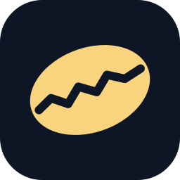
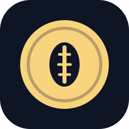
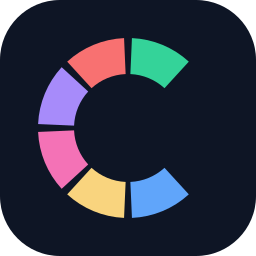
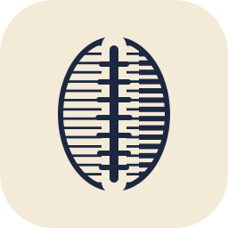

# Marca do Cauri

Cauri é o búzio, uma das moedas mais antigas do mundo. A logo escolhida (30/10/2026) é o
**selo** (9): um lacre de cera vinho com o búzio em relevo, sobre papel creme, e o nome em
Instrument Serif. O lacre combina com o Cauri ser fechado, só para convidados.

As outras propostas ficam aqui para o caso de trocar. Cada arquivo é o ícone em 64×64
(viewBox), sem dependência externa, exceto a 10, que usa a fonte Fraunces no "c" (sem ela
instalada, o navegador cai no Georgia).

| | Proposta | Ideia |
|---|---|---|
|  | Anterior | o C laranja que o app usou até 30/10/2026 |
|  | 1. Búzio | a concha vista por baixo, com a fenda dentada |
|  | 2. Búzio que sobe | a fenda dentada vira um gráfico subindo |
|  | 3. Espiral | um C de concha que também lembra juros compostos |
|  | 4. Moeda | o búzio cunhado numa moeda |
|  | 5. Carteira | o C é um gráfico de rosca com as cores das classes de ativo |
|  | 6. Horizonte | sol e uma serra cujo contorno é um gráfico |
|  | 7. Fieira | búzios num cordão, cada um mais alto que o anterior |
|  | 8. Guilloché | a roseta de linhas finas das cédulas, com o búzio no centro |
|  | **9. Selo** | **a escolhida** |
|  | 10. Serifa | o nome é a marca: "cauri" em Fraunces, com o pingo do i virando búzio |
|  | 11. Lapidado | o búzio cortado em facetas, como joia |
|  | 12. Gravura | o búzio desenhado a traço, como nota antiga |

## Onde a marca aparece

Para trocar de logo, mudar estes lugares juntos:

- `web/src/ui/Brand.tsx`: o ícone e o nome na barra do app e nas telas de acesso;
- `web/public/favicon.svg`: a aba do navegador (versão simplificada, sem o anel e os dentes,
  para ler bem em 16 e 32 px);
- `web/public/apple-touch-icon.png` e `icon-*.png`: o ícone da tela de início do celular
  (o iPhone não usa o SVG), gerados de `09-selo.svg` por `node scripts/icons.mjs` em `web/`.
  O do iPhone tem fundo grafite: atalho de site não acompanha o modo escuro do iOS;
- `web/src/theme/tokens.ts`: a fonte do nome (`font.brand`) e o creme do avatar
  (`avatarFrom` e `avatarTo`), que acompanha o papel do selo;
- `supabase/templates/acesso.html`: o topo e o botão do e-mail de acesso (em produção, colar
  de novo em Authentication, Emails, Templates);
- `docs/screenshots/`: refazer com `npx playwright test e2e/screenshots.spec.ts` e
  `node scripts/readme-shots.mjs` (em `web/`).
